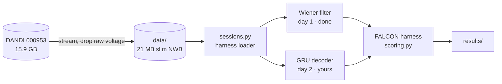

# Neuro Falcon

A finger-velocity decoder study on the [FALCON](https://snel-repo.github.io/falcon/) M2 benchmark (monkey motor cortex, 96 channels): how far a decoder trained on one week falls on later days, and how much new data it needs to recover.

| | Held-in R² (minival) | Held-out R², zero-shot |
|---|---|---|
| Wiener filter, 10 bins | 0.13 ± 0.12 | 0.01 ± 0.17 |

**Docs:** [Setup and use](docs/INSTRUCTIONS.md) · [System design](docs/SYSTEM-DESIGN.md) · [What's where](docs/FILE-STRUCTURE.md) · [Project brief](Neuro_falcon.md)

**Links:** [FALCON harness](https://github.com/snel-repo/falcon-challenge) · [M2 data on DANDI](https://dandiarchive.org/dandiset/000953) · [EvalAI leaderboard](https://eval.ai/web/challenges/challenge-page/2319/overview)
