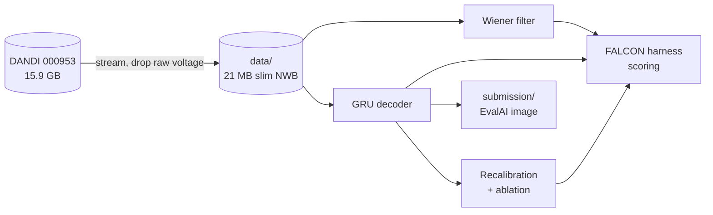

# Neuro Falcon

A finger-velocity decoder study on the [FALCON](https://snel-repo.github.io/falcon/) M2 benchmark (monkey motor cortex, 96 channels): how far a decoder trained on one week falls on later days, and what it takes to bring it back.

**Re-normalising the inputs with a few seconds of a new day's spikes (no labels) beats fine-tuning on up to 20 s of labelled data.**

| | Held-in R² (minival) | Held-out R², zero-shot | Held-out R², 20 s renorm |
|---|---|---|---|
| Wiener filter, 10 bins | 0.13 | 0.01 | n/a (refit: 0.13) |
| GRU, 64 units (3 seeds) | 0.31 ± 0.01 | 0.16 ± 0.01 | 0.31 ± 0.01 |

Zero-shot here is scored on whole runs through the harness; the renorm column is scored on each run's held-back second half (zero-shot on those same bins: 0.20). [Full ablation table](results/Ablation.md).

**Docs:** [Setup and use](docs/INSTRUCTIONS.md) · [System design](docs/SYSTEM-DESIGN.md) · [What's where](docs/FILE-STRUCTURE.md) · [Project brief](Neuro_falcon.md)

**Links:** [FALCON harness](https://github.com/snel-repo/falcon-challenge) · [M2 data on DANDI](https://dandiarchive.org/dandiset/000953) · [EvalAI leaderboard](https://eval.ai/web/challenges/challenge-page/2319/overview)
