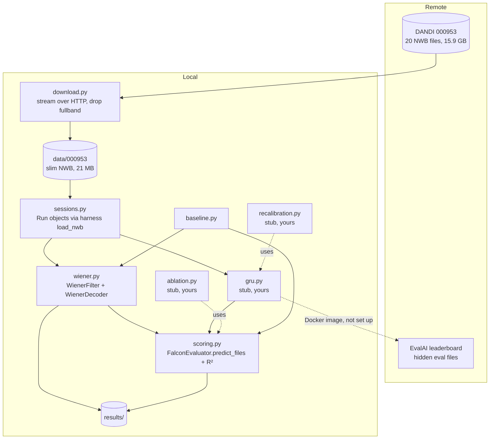

# System Design

## Architecture

## Components

| Component | Job |
|---|---|
| `download.py` | Lists dandiset 000953, streams each file with `remfile`, removes `acquisition/fullband` and writes a self-contained copy with `pynwb` export (`link_data=False`). |
| `sessions.py` | Wraps the harness's `load_nwb` so every number uses the same binning (20 ms), targets and `eval_mask` as the leaderboard. A `Run` is one file; its `key` (`Run1_20201030`) is the harness's own hash. |
| `wiener.py` | `WienerFilter`: ridge regression from 10 lagged bins of z-scored counts to 2-D finger velocity. `WienerDecoder`: the same model streamed one bin at a time behind the harness's `BCIDecoder` interface. |
| `scoring.py` | `score()` streams a decoder through `FalconEvaluator.predict_files` and computes the harness's variance-weighted R², one value per day (runs pooled), mean ± std across days. `minival()` runs the harness's official local path. |
| `baseline.py` | Day 1: fits on held-in calib, scores minival and zero-shot held-out, writes JSON and the chart. |
| `gru.py`, `recalibration.py`, `ablation.py` | Contracts for your parts. Docstrings and signatures only, no logic. |

## Main flows

1. **Download**: DANDI API → asset list → for each file, an HTTP range-read of everything except the raw voltage → `data/000953/<split>/<file>.nwb`.
2. **Baseline**: load 7 held-in runs → fit → (a) harness `evaluate(phase="minival")` on 7 minival files → (b) `predict_files` on 6 held-out calibration runs → per-day R² → `results/`.
3. **Your decoder** (planned): implement `BCIDecoder` in `gru.py` → `scoring.score` / `scoring.minival` → same table as the baseline.

## Where data lives

- `data/000953/…` holds the slim NWB files (git-ignored). The layout mirrors DANDI's, so the harness finds minival through its own `DANDI_FOLDER_MAP`.
- `results/baseline.json` and the PNG are committed.
- `results/harness/*.pkl` holds the prediction and ground-truth payloads the harness writes during `evaluate` (git-ignored).

## Key decisions and trade-offs

- **Slim download instead of the full dandiset.** 96% of each file is raw 30 kHz voltage that the M2 loader never touches. The full 15.9 GB wouldn't fit on the 9.4 GB free on this disk. The slim files load bit-identically through `load_nwb` (checked on one original minival file: spikes, velocity, trial_change and eval_mask all equal). Trade-off: no raw voltage, so no spike re-sorting or threshold experiments without another download.
- **Use the harness, don't reimplement it.** Loading, binning, streaming and the R² metric all come from `falcon_challenge` (pinned commit), so local numbers mean the same thing as leaderboard numbers. The cost is a heavy install (torch, hydra) for a linear baseline.
- **Held-out calibration runs as the local zero-shot test.** The real held-out eval files exist only on EvalAI. The calibration runs are labelled recordings from the same held-out days, so they're the closest local proxy. They are also the data a recalibration loop adapts on, so the recalibration curve has to keep adaptation bins and scored bins disjoint.
- **Wiener filter settings came from held-in data only.** A within-run 80/20 split gave R² 0.10 / 0.26 / 0.30 / 0.32 for 1 / 5 / 10 / 20 lag bins, and ridge strength barely mattered. 10 bins (200 ms) is near the plateau at half the features of 20. Held-out scores were not used to choose.
- **Strict zero-shot.** Normalisation statistics come from held-in days only. Re-z-scoring each new day would use unlabelled held-out data, which is a form of adaptation and belongs on the recalibration curve.

## Testing

- `tests/test_wiener.py` runs on synthetic data: the lag layout, causality (changing future bins doesn't change past predictions), streaming output matching batch output exactly, and recovery of a planted linear map (R² > 0.99).
- `tests/test_data.py` checks the real files: all 20 present, no `fullband`, no external links, correct shapes and harness keys.
- `tests/test_stubs.py` checks that your parts still raise `NotImplementedError`.
- End to end: `python -m neurofalcon.baseline` runs the harness's own evaluator.

## Known limits

- Minival files are 116–194 bins (about 3 s) each, so the minival R² is noisy. Treat the within-run split (0.30) as the better held-in estimate.
- Local held-out scores come from calibration runs, not the hidden eval split, so they won't match the leaderboard exactly.
- No leaderboard submission path yet: it needs a Docker image and an EvalAI account.
- Streaming one bin at a time in Python takes about a minute per scoring pass.
- Intel Mac: torch is capped at 2.2.2, which keeps numpy below 2.
