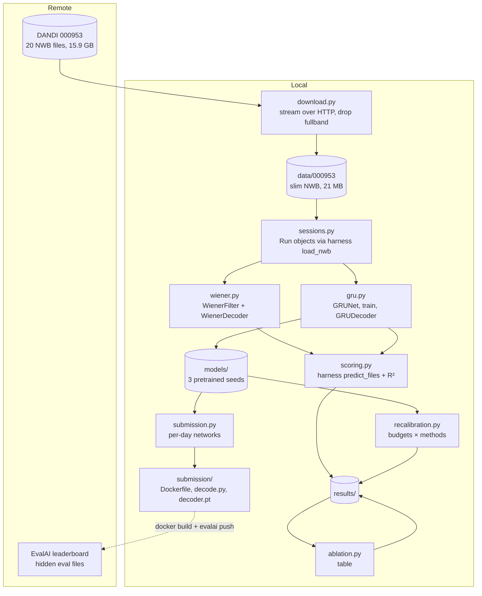

# System Design

## Architecture

## Components

| Component | Job |
|---|---|
| `download.py` | Lists dandiset 000953, streams each file with `remfile`, removes `acquisition/fullband` and writes a self-contained copy with `pynwb` export (`link_data=False`). |
| `sessions.py` | Wraps the harness's `load_nwb` so every number uses the same binning (20 ms), targets and `eval_mask` as the leaderboard. A `Run` is one file; its `key` (`Run1_20201030`) is the harness's own hash. Also holds the data-path constants, so the decoder imports nothing download-only. |
| `wiener.py` | `WienerFilter`: ridge regression from 10 lagged bins of z-scored counts to 2-D finger velocity. `alpha=None` picks the ridge strength on a time-ordered split, for small-data refits. `WienerDecoder` streams it behind the harness's `BCIDecoder`. |
| `gru.py` | `GRUNet`: z-score → input layer (96→32) → GRU (64 units) → readout (64→2), with input and output statistics as buffers. `train` fits any subset of parameters on random 2 s windows with a 0.5 s burn-in. `GRUDecoder` streams one bin at a time and picks a per-day network from each file's date. `pretrained()` loads or trains the 3 seeds in `models/`. |
| `scoring.py` | `score()` streams a decoder through `FalconEvaluator.predict_files` and computes the harness's variance-weighted R², per day (runs pooled), mean ± std across days. `minival()` runs the harness's official local path. Harness logging is silenced. |
| `recalibration.py` | For each held-out day, adapts the pretrained GRUs with each method on each budget and scores the day's held-back bins. Writes the JSON and the chart. |
| `ablation.py` | Turns the recalibration summary into the table in `results/Ablation.md`. |
| `submission.py` | Builds `submission/decoder.pt`: the seed-0 GRU as `default`, plus one network per held-out day, recalibrated (renorm by default) on all of that day's calibration data. |
| `submission/` | EvalAI image (`Dockerfile`, following the harness template) and the runfile `decode.py`. |

## Main flows

1. **Download**: DANDI API → asset list → for each file, an HTTP range-read of everything except the raw voltage → `data/000953/<split>/<file>.nwb`.
2. **Baseline** (`neurofalcon.baseline`): fit the Wiener filter on 7 held-in runs → harness minival → harness zero-shot on 6 held-out calibration runs → `results/baseline.json`.
3. **GRU** (`neurofalcon.gru`): pretrain 3 seeds → save to `models/` → the same two scores → `results/gru.json`.
4. **Recalibration** (`neurofalcon.recalibration`): for each seed, day, budget (2.5/5/10/20 s) and method → adapt on the first-half pool → R² on the second halves → `results/recalibration.json` and the chart.
5. **Ablation** (`neurofalcon.ablation`): summary → `results/Ablation.md`.
6. **Submission** (`neurofalcon.submission`, then `submission/decode.py`): per-day networks → harness `evaluate` locally (minival) or remotely (test) inside the image.

## Where data lives

- `data/000953/…` holds the slim NWB files (git-ignored). The layout mirrors DANDI's, so the harness finds minival through its own `DANDI_FOLDER_MAP`.
- `models/` holds the pretrained GRUs (93 KB each) and `submission/decoder.pt` holds the per-day networks. Both are committed, so the results reproduce without retraining.
- `results/*.json`, `*.png` and `Ablation.md` are committed. `results/harness/*.pkl` holds the payloads the harness writes during `evaluate` (git-ignored).

## Key decisions and trade-offs

- **Slim download instead of the full dandiset.** 96% of each file is raw 30 kHz voltage that the M2 loader never touches. The full 15.9 GB wouldn't fit on the disk. The slim files load bit-identically through `load_nwb`. Trade-off: no raw voltage, so no spike re-sorting or threshold experiments without another download.
- **Use the harness, don't reimplement it.** Loading, binning, streaming and R² all come from `falcon_challenge` (pinned commit), so local numbers mean the same thing as leaderboard numbers.
- **Held-out calibration runs as the local test.** The real held-out eval files exist only on EvalAI. The calibration runs are labelled recordings from the same days.
- **Recalibration split: first half adapts, second half scores, for every run.** This keeps adaptation and scored bins disjoint and keeps the order causal: data from the start of a session is used to predict its later part, as in a real session. Models still predict each whole run from its start, so the scored half sees the same context it would when streamed. Cost: zero-shot on second halves (0.20) isn't the same number as zero-shot on whole runs (0.16), so the curve's baseline is the second-half number.
- **Model choices came from held-in data only.** The Wiener filter uses 10 lag bins (within-run R² 0.10 / 0.26 / 0.30 / 0.32 for 1 / 5 / 10 / 20 bins). The GRU uses 64 units and 600 steps: its within-run validation R² was 0.555, against 0.572 for 128 units at 2.7× the cost, and 600 steps beat 1,500 (0.49, overfitting). Held-out scores never chose a setting.
- **Fair small-data reference.** With a fixed ridge strength, the Wiener refit on 20 s scored −0.78. Choosing the strength inside the budget (on a time-ordered split) fixed that, so the reference isn't a straw man.
- **Strict zero-shot.** Normalisation statistics come from held-in days. Re-z-scoring with new-day spikes is counted as adaptation: it's the renorm method, and it turned out to be the strongest one.
- **Submission uses renorm.** It was best at every budget in the ablation and needs no labels. Each day's statistics come from all of its calibration data, which FALCON allows.

## Results

| Measure | Wiener | GRU (3 seeds) |
|---|---|---|
| Held-in minival R² | 0.13 | 0.31 ± 0.01 |
| Held-in within-run 80/20 R² | 0.30 | 0.555 (seed 0) |
| Held-out zero-shot R² (whole runs, harness) | 0.01 | 0.16 ± 0.01 |

Recalibration, mean of 4 days (± over seeds), scored on held-back halves:

| Method | 2.5 s | 5 s | 10 s | 20 s |
|---|---|---|---|---|
| GRU zero-shot | 0.20 | 0.20 | 0.20 | 0.20 |
| renorm (no labels) | **0.28 ± 0.01** | **0.27 ± 0.02** | **0.30 ± 0.02** | **0.31 ± 0.01** |
| readout | 0.17 | 0.21 | 0.24 | 0.27 |
| input layer | 0.15 | 0.21 | 0.23 | 0.26 |
| full | 0.13 | 0.23 | 0.25 | 0.25 |
| scratch GRU | −0.21 | −0.11 | −0.04 | 0.06 |
| Wiener refit | −0.13 | −0.02 | −0.06 | 0.13 |

Readings: most of the day-to-day loss is a shift in per-channel firing statistics, which renorm undoes without labels. Labelled fine-tuning on 20 s or less doesn't beat it, and at 2.5 s it does worse than not adapting. Pretraining is worth more than 20 s of new-day labels: the scratch GRU and the Wiener refit trail far behind. The late days (19 and 24 Nov) stay hard for every method (best R² 0.16–0.20).

## Testing

- `tests/test_wiener.py`: the lag layout, causality, streaming output matching batch, recovery of a planted map, and that the ridge search picks a strong ridge on pure noise.
- `tests/test_gru.py`: streaming matches batch, reset clears state, the right per-day network is picked from DANDI file names, training lowers the error, and save/load round-trips.
- `tests/test_recalibration.py`: budgets come only from first halves and in time order, an over-large budget is an error, only second halves are scored, and runs group by day.
- `tests/test_data.py`: all 20 real files are present and self-contained, with the correct shapes and keys.
- End to end: every entry point runs through the harness's own evaluator. `submission/decode.py` was run locally against minival through `FalconEvaluator.evaluate`.

## Known limits

- Minival files are about 3 s each, so the minival R² is noisy.
- The local held-out scores come from calibration runs, not the hidden eval split.
- Only 4 held-out days, so the day-level conclusions rest on few days. Seeds vary only the GRU's training, not the data.
- Fine-tuning runs a fixed 300 steps at lr 1e-3 for every budget. Tuning that per budget might help the labelled methods, but tuning it on held-out days would leak.
- The Docker image hasn't been built locally: the disk was too full (4 GB free) and Docker wasn't running. `decode.py` is verified outside Docker.
- CPU only (Intel Mac, torch 2.2.2). The full recalibration grid takes about 1.7 h on a loaded machine.
